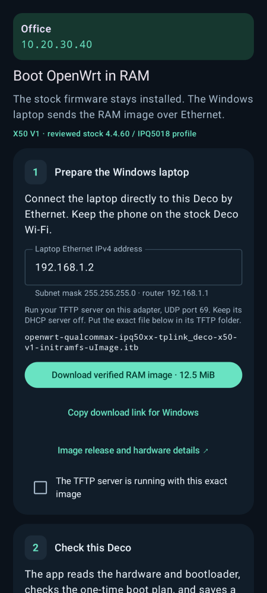

# Deco X50 Persistent Root & OpenWrt RAM

[Русская пошаговая инструкция](README.ru.md) · [Download v1.1.1](https://github.com/skin4ik123/deco-x50-perm-root-openwrt/releases/tag/v1.1.1) · [Build from source](docs/BUILD.md)

**Deco Control** is an English Android app for the reviewed **TP-Link Deco X50 V1 EU** stock firmware. It configures persistent local root SSH, provides a terminal/files/diagnostics, and guides a one-time OpenWrt RAM boot using a Windows laptop and Ethernet. A separate guarded Ethernet-switch repair is included.

**Experimental release. The app boots OpenWrt in RAM. Installing permanent OpenWrt from the running RAM system is possible and has now been confirmed by the owner on Deco X50 V1; it is a separate installation step, not an automatic action of this app.** Root setup changes the stock persistent configuration. RAM boot writes a one-time command to the single-copy boot environment before rebooting; keep power stable and retain the app's private backups. Only use devices you own or are authorized to administer.

## Compatibility

| Item | Reviewed configuration |
|---|---|
| Phone | Android 8 or newer, ARM64 |
| Stock device | Ordinary Deco X50 V1 EU, hardware 1.0, IPQ5018/aarch64, kernel 4.4.60; exact OEM fingerprints must match |
| OpenWrt | Oein `deco-x50-v1-r37324.2`, exact original initramfs image below |
| Switch repair | That original image, kernel 6.18.55, classic RTL8367S `6367/00a0`, CPU port 6 / extif1 |
| Not supported here | X50 V3/MediaTek, unreviewed builds/regions, M4/M4R, automatic permanent installation through the app |

A similar model name or kernel version alone does not establish compatibility. The app refuses mismatched stock fingerprints. The switch helper checks kernel/module state but does not independently establish all board/chip prerequisites.

## What to download

Open [release v1.1.1](https://github.com/skin4ik123/deco-x50-perm-root-openwrt/releases/tag/v1.1.1):

| File | For |
|---|---|
| `Deco-Control-1.1.1-arm64.apk` | Install on the phone |
| `Deco-Control-X50-Ethernet-RAM-v1.zip` | Repair the known classic-switch issue after RAM boot |
| `QUICKSTART_RU.md` | Downloadable Russian walkthrough |
| `SHA256SUMS.txt` | Check downloaded files |
| `Deco-Control-1.1.1-sources.zip` | Application and toolkit source snapshot |
| `Deco-Control-RTL8367S-GPL-Sources-v1.zip` | Full corresponding switch-module sources and build inputs; developers only |

The RAM firmware is downloaded from its [original author](https://github.com/Oein/Deco-X50-Firmware-Unpack/releases/tag/deco-x50-v1-r37324.2), either through the app or with the direct link below. It is not bundled in the APK or rebranded as our firmware.

<details><summary>App preview (synthetic test device)</summary>



</details>

## 1. Set up root

1. Connect the phone to the stock Deco Wi-Fi. Install the APK. In **Devices**, add your Deco's current local IPv4 and a name, then open it.
2. Tap **Set up root**. Already rooted? Use **Already have root? Sign in** instead.
3. Enter **Mesh controller IP address**: the main Deco's address, even when the selected target is a satellite. This is the main Deco, not an upstream MikroTik.
4. Under **Owner email or SSH username** and **Owner password**, enter the TP-Link owner account email/password for this Deco network. These authenticate to the local stock service; this is not the Wi-Fi password or the new root password. Tap **Check owner access**.
5. After **Owner access verified**, enter and repeat a separate root password of at least 12 characters, confirm **Deco X50 · V1 · EU**, and tap **Install root** once.
6. The app checks compatibility and saves a configuration backup before the change. Root setup does not automatically reboot. Sign in as `root` on port 22 with the new password; the app offers terminal, files, monitoring and diagnostics.

The startup hook and independent SSH credential are stored in persistent stock data. Ordinary stock reboot persistence is implemented; use **Verify startup** after a planned reboot to check it on your device. OTA/factory-reset survival is not promised. IP changes can also make a bound service unreachable. Export backups to your own private storage, never an issue attachment.

## 2. Prepare Windows and the original RAM image

1. Connect the laptop directly to the target Deco by Ethernet. Keep the phone on stock Wi-Fi.
2. Windows: press **Win+R**, enter `ncpa.cpl`, open **Ethernet → Properties → Internet Protocol Version 4 → Properties**. Set IP **192.168.1.2**, mask **255.255.255.0**, leave gateway/DNS blank. Remember to restore automatic addressing afterwards.
3. Install a TFTP server from the [official Tftpd64 releases](https://github.com/PJO2/tftpd64/releases). Set its directory to e.g. `C:\TFTP`. Enable TFTP, disable its DHCP server. In Settings restrict/bind TFTP to Ethernet **192.168.1.2**; selecting the interface dropdown alone does not restrict all interfaces in recent Tftpd64. Permit the application through Windows Firewall for this direct connection; do not disable the whole firewall.
4. Download the exact firmware into that folder using the app's **Download verified RAM image · 12.5 MiB → Share image to laptop**, or this [direct upstream download](https://github.com/Oein/Deco-X50-Firmware-Unpack/releases/download/deco-x50-v1-r37324.2/openwrt-qualcommax-ipq50xx-tplink_deco-x50-v1-initramfs-uImage.itb).

```text
Filename: openwrt-qualcommax-ipq50xx-tplink_deco-x50-v1-initramfs-uImage.itb
Bytes:    13056916
SHA-256:  ce2c49c0fb6dadea9e6430cba9a39ca03f833bb6b20df7d63a9d0ddefeec4ee2
```

Do not rename an NSS, sysupgrade, factory/recovery or modified image to this name. The app's boot command pins this file's length/CRC. Windows may hide extensions: ensure it did not become `.itb.itb` or `.itb.bin`.

## 3. Boot and verify

1. In Deco Control select the correct device, then **Tools → OpenWrt RAM boot**.
2. Set **Laptop Ethernet IPv4 address** to `192.168.1.2`. Tick **The TFTP server is running with this exact image**.
3. Tap **Check compatibility and back up**. This stage reads and saves state; stock keeps running.
4. At **Ready for a RAM boot**, tap **Boot OpenWrt in RAM**, review the device, then confirm **Boot OpenWrt**. This interrupts that Deco's service and reboots it.
5. Watch the TFTP transfer on Windows. On the phone join **X50-OpenWrt** and tap **Verify OpenWrt over SSH**. Successful device/boot/operation verification enables **Open OpenWrt terminal** and **Open LuCI**.
6. LuCI is at **http://192.168.1.1/**. The reference image initially has open Wi-Fi and no root password. Keep the trial isolated. App 1.1.1's initial RAM verifier expects that empty password; verify before changing it. After setting your own root password, use normal PC SSH/LuCI for new connections.

The one-time boot command restores the original boot policy before TFTP. A later power cycle is intended to load stock again. If the app reports an uncertain write/reboot, preserve the journal and use its stock-state check/guarded restore, not another Boot attempt.

## 4. Fix the classic RTL8367S Ethernet issue

Use this only with the exact original RAM image and classic-switch variant above. The known failure includes `HSGMII is only supported on RTL8367S-VB extif0`, `chip setup failed, err=-22`, no `switch0`, and no wired access even with a static IP. If Ethernet already works, skip this step.

1. Unzip `Deco-Control-X50-Ethernet-RAM-v1.zip` on Windows.
2. Connect laptop Wi-Fi to **X50-OpenWrt**. Temporarily unplug Ethernet to avoid competing routes to `192.168.1.1`.
3. Run **Upload-Windows.cmd**. It only copies the helper/module to `/tmp`; it does not apply them. The initial reference root password is empty. Then open PowerShell:

```powershell
ssh root@192.168.1.1
```

4. In that **router SSH terminal**, run the first command **once**:

```sh
sh /tmp/InternetDeco_X50_Ethernet_RAM_v1.sh --apply
```

Continue only after `FAMILYC_DRIVER_REGISTERED=1`, `DRIVER_BOUND=1`, `MODULE_STATE=live`, and `switch0` appears. `VLAN_APPLY_NOT_RUN=1` is expected at this point.

5. Apply the existing VLAN configuration **once**:

```sh
swconfig dev switch0 load network
swconfig dev switch0 show
```

No extra `set apply`, UCI commit or network/Wi-Fi restart is needed. Keep logical CPU port **6**; do not replace it with the hardware MAC alias 8.

6. Reconnect Ethernet to a LAN jack (top/middle are the reference layout), restore Windows automatic IPv4/DNS, turn laptop Wi-Fi off briefly, and open **http://192.168.1.1/**. Wired access was physically confirmed after these two steps. All jack roles and sustained performance have not been exhaustively tested.

If the result is uncertain, only inspect:

```sh
sh /tmp/InternetDeco_X50_Ethernet_RAM_v1.sh --status
```

Do not delete the one-shot marker or replay `--apply`. This repair is volatile and does not write NAND/MTD or the boot environment. It is not an NSS repair and must not be applied to the separate NSS image merely because its kernel also says 6.18.55.

## 5. Return to stock

Power-cycle after a confirmed RAM boot, join the stock Wi-Fi, restore normal PC networking, and use **Check stock state at …** in the app. For uncertain boot-policy outcomes use the app's saved-state recovery first. Do not use `sysupgrade`, `mtd write`, raw UBI writes or factory Reset as part of this guide. Logs/backups must be retained when diagnosing an uncertain operation.

## Troubleshooting and evidence

See [the Russian walkthrough and FAQ](README.ru.md). SSH banner delays are allowed: default 90 seconds and up to 3 transport attempts, configurable 30–120 seconds /1–3 attempts. Authentication/key errors and destructive operations are not automatically repeated. No cause of a live Dropbear delay is claimed from a VM test.

APK1.1.1: 44 Rust tests, 83 JVM tests, CheckJNI/private-storage checks and signature/16KiB alignment were recorded. The full APK wizard on a physical phone is not established by those tests. Earlier root provisioning, TFTP image boot, and the separate two-step Ethernet fix were owner-confirmed on hardware. The owner has additionally confirmed permanent installation from the running RAM system; the exact flashing image/commands are not part of the app wizard or this RAM walkthrough. OTA persistence of stock root is not established.

## Source, credits and licenses

Application source is GPL-3.0; included Termux/Dropbear components retain their notices in [third-party](third-party/NOTICE.md). The separate switch work is GPL-2.0; its complete sources/inputs are supplied in the full-source release ZIP. No optional proprietary Realtek SDK reference is redistributed. Firmware belongs to [Oein's experimental X50 project](https://github.com/Oein/Deco-X50-Firmware-Unpack); see its pinned release for source/build details. Tftpd64 belongs to its authors and is not bundled.

Unofficial project, not affiliated with TP-Link or OpenWrt. This repository contains no owner credentials, device calibration, NAND backups or signing keys. See [SECURITY.md](SECURITY.md) before submitting diagnostics.
